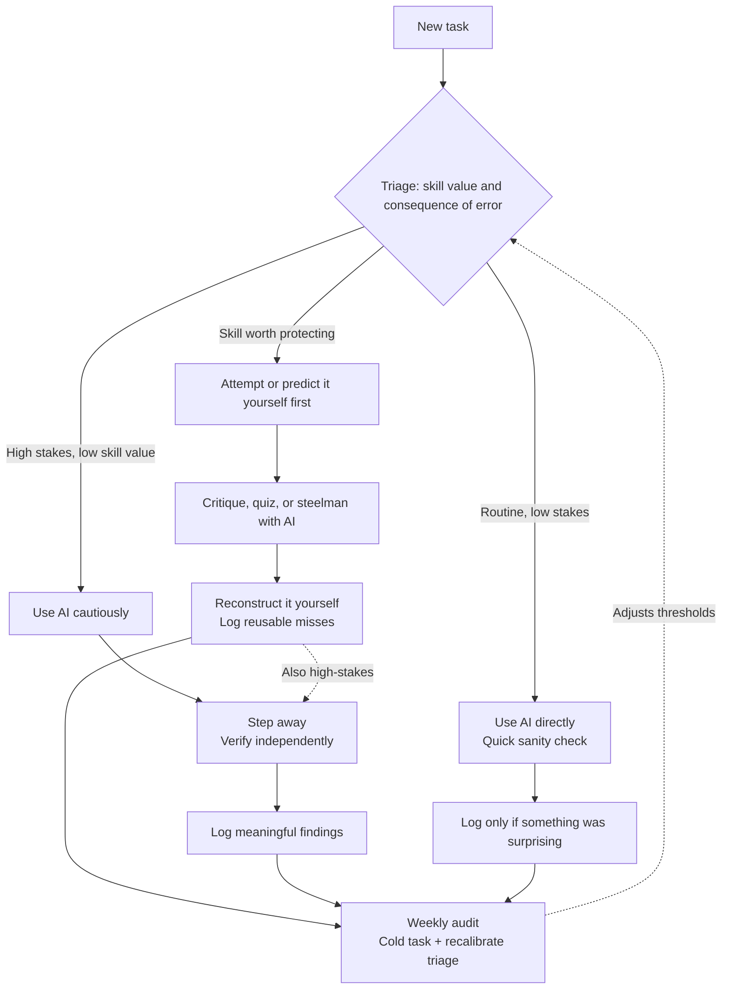
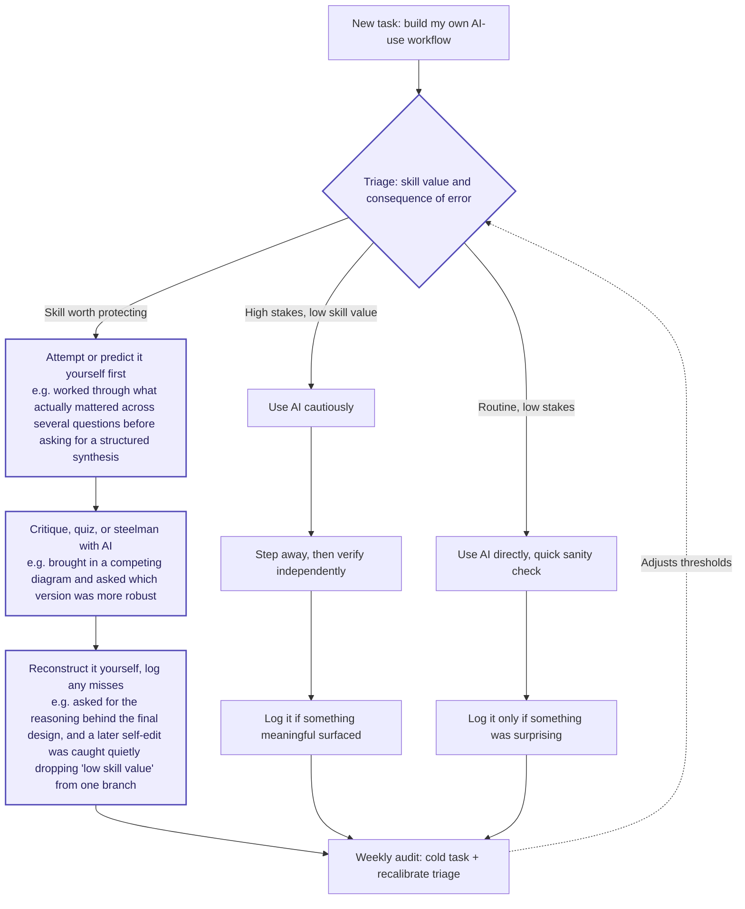

## Core principle

A workflow becomes a trustworthy mental model through repeated practice, correction, and getting caught being wrong.

The audit and the log are not optional scaffolding to discard once the steps feel automatic. They are what make the automatic version trustworthy instead of merely fast.

## Operating workflow



## Ten-second triage

Ask two questions:

1. Is this a skill I want to retain or develop?
2. What would it cost if the answer were wrong?

Then choose the appropriate path.

If those two questions don't give a clear read, check the skill-value question against these instead:

- Will I need to do this again without AI available?
- Does the value come from the result, or from doing it myself?
- Could I explain this cold, right now, in five minutes?
- Will I be doing this often?

A yes to any of these usually means protect it.

### Routine and low stakes

Examples:

- Reformatting text
- Scheduling
- Boilerplate
- Syntax lookup
- Converting a file from one format to another

Use AI directly. Perform a quick sanity check. Do not add further process unless something seems wrong or surprising.

### Skill worth protecting

Examples:

- Interview problems
- Architecture decisions I want to understand
- Writing or reasoning I may need to reproduce unaided
- Learning an unfamiliar technical concept
- Forming an argument or point of view

Attempt or predict before asking AI for help.

### High stakes and low skill value

Examples:

- Comparing job offers
- Reviewing an important one-off document
- Interpreting a consequential policy or contract
- Making a decision with meaningful financial, professional, or personal consequences

Use AI as an input, not as the final authority. Step away before committing and verify independently.

When a task is both skill-protecting and high-stakes, follow both paths: attempt it yourself, use AI critically, and verify independently.

When unsure, take the more careful path.

## How to run each path

### Routine tasks

Use AI directly and perform a quick sanity check.

Log the interaction only when something was surprising, such as:

- A confident but obvious error
- A result that changed the way I think about the task
- A supposedly routine task that turned out to require judgment
- Evidence that I classified the task too casually

Otherwise, skip the overhead. That is the purpose of the routine path.

### Skills worth protecting

#### 1. Attempt or predict first

Take a real crack before asking AI.

The attempt can be brief:

- An estimate
- A draft
- A proposed solution
- A list of constraints
- A prediction
- A tentative opinion
- Two lines describing my approach

The point is not to finish the task alone. The point is to retrieve what I know, expose what I do not know, and establish my own framing before seeing the AI's.

Watch for the feeling of relief immediately before opening AI. That may indicate I am about to avoid useful effort rather than save time.

#### 2. Use AI adversarially

Give AI my attempt and ask it to challenge me rather than immediately replace my work.

Useful prompts include:

- "What is the weakest part of this approach?"
- "What edge cases am I missing?"
- "Quiz me on this."
- "Argue for the option I am not leaning toward."
- "What assumptions am I treating as facts?"
- "Compare this against the strongest alternative."
- "Do not solve it yet. Give me a hint or ask me a question."

#### 3. Reconstruct without AI

After receiving help, close or stop relying on the conversation and try to reproduce the important part myself.

Ask:

- Can I explain the reasoning, not merely the conclusion?
- Can I apply it to a slightly different case?
- Can I identify why my original attempt failed?
- Could I do the central part again without copying?
- Do I know which parts came from me and which came from AI?

Reconstruction does not require memorizing every detail. It means retaining the central reasoning or capability I intended to protect.

#### 4. Log reusable misses

Do not log every typo or minor correction.

Log misses that reveal something reusable, such as:

- A misconception
- A recurring blind spot
- An edge case I repeatedly forget
- An AI error I nearly accepted
- A failure to verify an important claim
- Something I understood while reading but could not reconstruct
- A task I placed in the wrong branch
- A revision that improved the wording while accidentally changing the meaning

A useful entry records:

- Task or domain
- What I initially thought
- What was wrong or missing
- How I caught it
- Whether I would have caught it without checking
- What rule or habit should change

### High-stakes, low-skill-value tasks

Use AI cautiously. It may organize information, surface tradeoffs, identify questions, or reveal assumptions, but it does not make the final decision.

#### 1. Ask AI to expand the decision

Useful requests include:

- Surface tradeoffs
- Identify missing information
- Challenge my preferred option
- Distinguish facts from assumptions
- Generate questions for an expert
- Identify possible downside scenarios

#### 2. Step away before committing

Allow time for the anchoring effect and the fluency of a confident answer to fade.

Depending on the decision, that might mean:

- Taking a walk
- Revisiting it several hours later
- Sleeping on it
- Writing my own conclusion without looking at the AI response

The purpose is not delay for its own sake. It is to determine whether the answer still feels compelling once it is no longer the most recent confident thing I have read.

#### 3. Verify independently

Use something that is not merely the same AI answering again.

Examples:

- A primary source
- Official documentation
- Direct testing
- Original data
- A qualified professional
- A trusted mentor
- The actual contract, policy, or offer document
- My own calculations or comparison

Another AI may provide a useful second perspective, but it is not fully independent verification.

#### 4. Log meaningful findings

Log something only when it could improve future judgment, such as:

- A material fact I had overlooked
- A false or unsupported AI claim
- A bad assumption in my framing
- A sign that I was anchored on the first answer
- A question I should routinely ask in similar decisions
- Evidence that the task also involved a skill worth protecting

## Weekly AI-use audit

Complete this once per week.

### Cold task

Choose one recent task that involved a skill I want to retain.

Attempt or explain it without reopening the AI conversation.

- Task:
- Could I complete or explain it without AI?
- What could I reconstruct accurately?
- Where did my understanding break down?
- What should I practice again?

### Log review

Scan for patterns rather than reviewing every entry individually.

- Where did I let AI form my view before I formed one?
- What errors or weak assumptions did I catch?
- What errors might I have missed?
- Which blind spots appeared more than once?
- Did I confuse understanding an answer with being able to reproduce it?
- Did any routine task actually require more judgment than I gave it?
- Did I overuse the protected path and create unnecessary friction?
- Did I underuse it and skip useful effort?

### Recalibration

Choose one adjustment for the coming week.

- A task category to move into a more careful branch
- A task category that can safely become routine
- A recurring miss to practice
- A verification source to use more often
- A prompt pattern to stop using
- A prompt pattern that produces better thinking

One adjustment for next week:

## Miss log template

```markdown
### YYYY-MM-DD: Task or domain

- Branch used:
- What I initially thought:
- What was wrong or missing:
- How I caught it:
- Would I have caught it without checking?
- Reusable lesson:
- Adjustment:
```

## Reasoning behind the design

### Two triage axes, not one

Asking only whether a task is worth practicing is insufficient.

A one-off task may have little long-term skill value but still be costly to get wrong. Skill value and consequence of error therefore need to be evaluated separately.

Crossing those axes produces three useful categories:

- Routine and low stakes
- Skill worth protecting
- High stakes and low skill value

A task can also belong to both careful categories. In that case, the protections should be combined.

### Different protections for different failure modes

The branches do not share one universal protocol because their risks differ.

For skill-protecting tasks, the central risk is skipping the retrieval, prediction, and reconstruction that build capability. The response is:

- Attempt first
- Invite criticism
- Reconstruct
- Log reusable misses

For high-stakes tasks, the central risk is committing to a costly decision because an answer sounded fluent and authoritative. The response is:

- Use AI cautiously
- Step away
- Verify independently
- Log meaningful findings

Applying the same ritual everywhere would either overburden routine work or underprotect consequential decisions.

### Logging is scaled to consequence

Logging every interaction would create enough friction and noise that the practice would likely be abandoned.

The threshold therefore changes by branch:

- Protected skill: log reusable misses
- High stakes: log meaningful findings
- Routine: log only surprises

The purpose of the log is not to document activity. It is to reveal recurring weaknesses and improve future judgment.

### Reconstruction is different from receiving an explanation

An explanation can feel clear without producing durable understanding.

Reconstruction requires me to reproduce, explain, or apply the important reasoning without relying on the conversation. It tests capability rather than familiarity.

### Independent verification must actually be independent

Asking the same AI again, or asking another AI trained on similar material, can provide another perspective but may reproduce the same assumptions or errors.

For consequential claims, verification should involve primary sources, testing, original data, or informed human judgment whenever possible.

### The audit loops back to triage

Drift often begins before the workflow is executed.

I may gradually classify more tasks as routine, open AI earlier, or stop noticing which abilities I am outsourcing. An audit that reviews only execution would miss this.

The weekly loop therefore recalibrates the sorting decision itself.

### The workflow is deliberately compact

A workflow only becomes a mental model if it is used repeatedly.

Every step must address a specific failure mode. Extra completeness is counterproductive when it adds enough friction that I stop following the system.

The main failure modes this workflow is designed to counter are:

- Skipping useful retrieval
- Letting AI establish the initial framing
- Accepting an unchallenged first answer
- Confusing recognition with understanding
- Anchoring on fluent output
- Trusting claims without independent verification
- Quietly moving more work into the routine branch
- Failing to learn from repeated misses

The goal is not to minimize AI use. It is to use AI in ways that improve output without quietly replacing the judgment and abilities I want to keep.

## Example Use Cases

Routine, low-stakes examples

Use AI directly, then sanity-check:

* Reformatting resume bullets without changing the substance
* Converting notes into a checklist
* Cleaning up Markdown for Obsidian
* Renaming files consistently
* Summarizing a meeting you already understand
* Generating boilerplate code
* Looking up syntax you already broadly know
* Turning rough notes into a polished email
* Comparing two formatting options
* Converting data between JSON, CSV, and Markdown
* Drafting routine calendar descriptions
* Brainstorming names, titles, or headings

Skill worth protecting examples

Attempt or predict first, then use AI to critique or quiz you:

* Solving an interview coding problem
* Designing a system architecture
* Debugging code you want to understand
* Learning C#, networking, databases, or operating systems
* Writing an argument or forming an opinion
* Reviewing a pull request
* Estimating time or space complexity
* Designing a database schema
* Explaining how a protocol or state machine works
* Writing an important section of a cover letter in your own voice
* Planning how you would implement a feature
* Preparing answers to behavioral interview questions
* Reading technical documentation and predicting how an API works
* Evaluating tradeoffs between frameworks
* Practicing concise professional communication

For example, with an interview problem:

1. Solve or outline it yourself.
2. Ask AI to find edge cases.
3. Rewrite the solution without looking.
4. Log any misconception you uncovered.

High-stakes, low-skill-value examples

Use AI as input, then step away and verify independently:

* Comparing job offers
* Reviewing an employment agreement
* Interpreting benefits, equity, or vesting terms
* Deciding whether to relocate for a role
* Evaluating a large purchase
* Reviewing a lease
* Preparing questions for a doctor, lawyer, accountant, or recruiter
* Assessing whether an email could damage a professional relationship
* Deciding how to respond to a sensitive workplace situation
* Reviewing application instructions with serious consequences
* Comparing insurance or financial options
* Interpreting an unfamiliar policy or official requirement

For example, with two job offers:

1. Ask AI to structure the tradeoffs.
2. Identify what information is missing.
3. Write your own conclusion separately.
4. Sleep on it.
5. Verify compensation, benefits, and terms from the actual offer documents.
6. Talk it through with someone whose judgment you trust.

Both skill-protecting and high-stakes

These deserve both paths:

* Designing software for a medical device
* Making a major architecture decision for a real product
* Writing code that handles authentication, payments, or private data
* Preparing for a final-round interview
* Drafting a consequential professional message
* Evaluating whether to accept a software role
* Publishing technical claims under your name
* Making a security-sensitive implementation decision
* Contributing code to production systems
* Planning a project you will need to defend in an interview

For these, attempt first, invite criticism, reconstruct the reasoning, step away when appropriate, and verify independently.

## Visual Example


The highlighted nodes are the path this actual conversation took. Everything else stays in the diagram as structure, not filled with invented examples, since this one is about what really happened, not what could happen.

**Where it landed.** Building a workflow you'll need to explain, adapt, and apply without AI later is exactly the "skill worth protecting" case, not routine and not a one-off high-stakes call. That's why it went down the middle branch.

**Attempt first.** Before any synthesis got asked for, there were three rounds of real back and forth: naming the concern, asking how to use AI long-term, asking specifically how to prevent erosion. That's what "attempt or predict it yourself first" looked like here, not a blank draft, but forming an actual point of view through those exchanges before asking for it to be organized into something usable.

**Critique with AI.** The clean example is pasting in a competing diagram and asking which was more robust. That's the textbook version of this phase, an outside artifact used specifically to find what the first version missed, rather than asking for validation of it.

**Reconstruct, log misses.** Asking for the reasoning behind the design was the reconstruction check, can the thing be explained back, not just followed. The concrete miss came a bit later and outside the clean order: a self-edited version quietly dropped "low skill value" from one branch's label, and that got caught and corrected. Real processes double back like that. The diagram makes it look linear; this one wasn't, and that's fine.

**What hasn't happened.** The weekly audit is the one node with nothing real to point to yet, because it needs actual time and actual distance, a cold task, a week's worth of log entries to scan for a pattern. That can't happen inside a single sitting no matter how thorough the sitting is. Worth checking back on once there's been a real week to audit.
